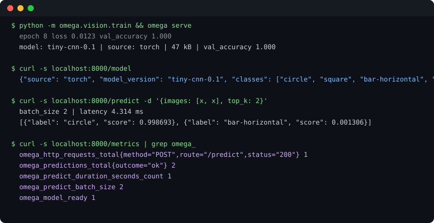

# Project Omega

**A small vision model, served the way production serving actually works:** a tiny PyTorch CNN, a FastAPI inference API, Prometheus metrics, structured logs, and a benchmark you can re-run. Repo `project-omega`, package and command `omega`.



[](https://github.com/mgkvibez/project-omega/actions/workflows/ci.yml)
[](https://pypi.org/project/omega-vision/)
[](LICENSE)
[](pyproject.toml)

## The numbers, measured

Trained here, on CPU, from a clean checkout with one command. Not a screenshot of somebody else's benchmark:

| | |
|---|---|
| Validation accuracy (4 classes, synthetic shapes) | **1.000** |
| Training time | **2.32s** for 8 epochs on 1200 samples |
| Checkpoint size | 47 kB |
| Batch 1 latency | p50 **0.179 ms**, p95 0.21 ms, p99 0.255 ms |
| Batch 8 latency | p50 **1.388 ms**, p95 1.555 ms, p99 1.744 ms |
| Batch 32 latency | p50 **7.606 ms**, p95 8.033 ms, p99 8.588 ms |
| Throughput | 5366 to 5700 images/s |

Reproduce with `python -m omega.vision.train --meta models/tinycnn.meta.json` and `python -m omega.vision.bench --checkpoint models/tinycnn.pt --runs 40`. Raw figures live in [docs/bench.json](docs/bench.json).

**One reading worth stating plainly:** throughput does not improve with batching here (5366 img/s at batch 1, 4303 img/s at batch 32). For a model this small, per-call overhead dominates, so batching gains nothing. That is a property of a 47 kB model, not of batching.

## What this is not

This is a **tiny CNN trained on synthetic shapes**. The 100% validation accuracy is a statement about four synthetic shapes, not about real-world vision. There is no ImageNet result here, no pretrained weights, no GPU, and no accuracy claim I cannot reproduce in front of you. The reason the repo exists is the part around the model that demos usually skip: validation, readiness, metrics, logs, and honest load reporting.

```bash
pipx install omega-vision && omega --version
```

## The API

```
GET  /health    liveness only, deliberately says nothing about the model
GET  /ready     200 with the predictor's real source, 503 when nothing is loaded
GET  /model     what is actually serving: source, classes, sizes, load time
POST /predict   images in, top-k labels and scores out
GET  /metrics   Prometheus text exposition
```

```bash
python -m omega.vision.train                       # writes models/tinycnn.pt
OMEGA_CHECKPOINT=models/tinycnn.pt omega serve     # uvicorn on :8000
curl -s localhost:8000/predict -H 'content-type: application/json' \
  -d '{"images": [[[0, 0.5], [1.0]]], "top_k": 2}' | jq
curl -s localhost:8000/metrics | grep omega_predict
```

Exit codes: `0` success, `2` a missing dependency (for example `omega train` without torch installed).

## Observability

| Metric | Type | Why it exists |
|---|---|---|
| `omega_http_requests_total{route,method,status}` | counter | traffic and error mix by route |
| `omega_http_request_duration_seconds{route}` | histogram | latency by route, buckets sized for sub-second APIs |
| `omega_predictions_total{outcome}` | counter | images scored, split ok / invalid / error / not_ready |
| `omega_predict_duration_seconds` | histogram | time inside the model call only, not the HTTP shell |
| `omega_predict_batch_size` | gauge | what the last request actually asked for |
| `omega_model_ready` | gauge | 1 when a predictor is loaded |
| `omega_model_load_seconds` | gauge | the startup cost nobody usually records |

Two decisions in the instrumentation worth naming. Scrapes of `/metrics` are **not** counted, because counting them inflates every dashboard that reads them. Unknown paths are labelled `route="unmatched"` rather than carrying the requested path, because a raw path is an unbounded label and one scanner can explode your time series. Requests that raise are still counted, as `status="500"`, since the failures are exactly the requests you cannot afford to have invisible.

Logs are one JSON object per line with a request id that is honoured if the caller supplies `x-request-id` and generated otherwise.

## How the torch-free core works

Serving depends on a `Predictor` protocol, not on PyTorch. `create_app(predictor=...)` takes any object with `predict(batch) -> probabilities`, so the whole HTTP surface is tested in under a second with no model, no GPU and no 200MB download. Torch sits behind a single adapter (`omega/vision/torch_model.py`) and is an optional extra.

The honesty is enforced, not just documented: if a checkpoint is missing, or torch is not installed, the service falls back to a clearly-labelled `stub` predictor, `/model` reports `source: "stub"`, and `/ready` says which. It never pretends real weights are loaded.

CI has two jobs. `test` runs the torch-free suite on Python 3.9 and 3.12. `ml` installs CPU torch, runs the torch tests, trains the model, asserts validation accuracy of at least 0.9, and publishes the benchmark it measured as a build artifact.

## Limits

- Synthetic four-class shapes only. A real vision task needs a real dataset, and this repo does not have one.
- Single process, single thread per request, no batching queue. Throughput numbers above are CPU on one machine.
- The stub exists for tests and for a clearly-labelled degraded mode. It is not a model.
- Python 3.9+ and CPU only. Nothing here has been run on a GPU.

## License

MIT.
